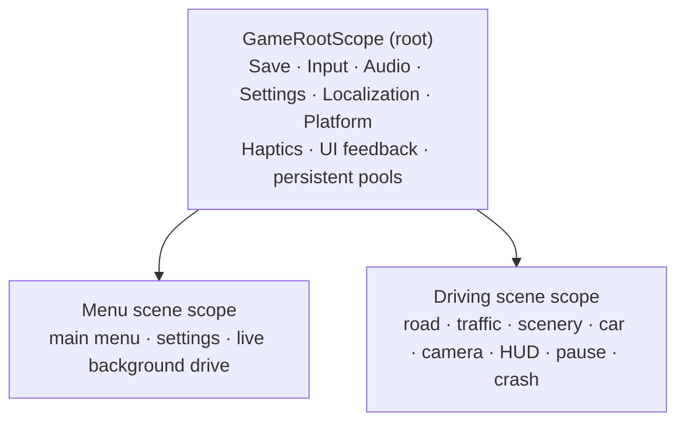
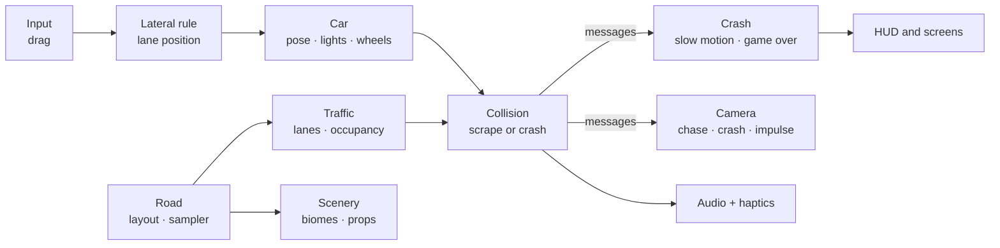

# WrongLine

[Türkçe](README.tr.md)

*Stay on the road. Thread the traffic. Don't blink.*

&nbsp;&nbsp;

<em>A run by day (left) and at night (right), both at double speed.</em>

WrongLine is a portrait Android driving game on an endless road that rises, dips and bends like a roller coaster. The
horizon curves away with a shader, the camera rides behind the car, and the road has four lanes: two go your way, two
come at you. You steer by dragging a finger sideways; there is no gas and no brake, and the car keeps getting faster. A
light scrape pushes you back onto your lane. A real hit is a crash: slow motion, the car comes apart and the run is over.

It is a small, finished game built as a portfolio piece: a real Unity project with clean rules, tests and a framework under
it, rather than a prototype.

## How to play

- **Drag to steer.** Slide a finger left and right; the car follows across the four lanes. Speed is not yours to control.
- **The two left lanes are oncoming.** They are the fast way through, and the risky one.
- **A scrape is not a crash.** A shallow side contact shoves the car away and costs nothing; anything deeper is a crash.
- **It keeps getting faster.** Speed climbs over the run, so the same gap gets narrower the longer you last.
- **Distance is the score.** The game-over screen counts your meters up and shows your best run.
- **The world changes.** Four biomes, day or night at the start, street lamps and headlights after dark. Every run is a
  different road.

## Screenshots

*Main menu, settings, the driving HUD by day and by night, and the crash screen.*

## Download

An Android APK (Android 7.1 or newer, ARM64) is attached to the project's
[GitHub Releases](https://github.com/ramazantoy/WrongLine/releases) once a release is published. It is signed with a debug
key, so install it by allowing installs from unknown sources; Play Protect may warn about an unknown developer. The game is
not on any store. The APK is not kept in the repository and can be rebuilt from source (see below).

## Status

Playable from the menu to the crash screen, in English and Turkish, with sound, music and vibration (each can be switched
off in Settings). What is still rough, so nobody has to find it out:

- Not yet measured on a phone: frame rate, heat and how the controls feel are still to be checked on real devices.
- The sounds are my own synthesis and have only had a first tuning pass; the balance between engine, effects and music is
  not final.
- The player car is a 120k-triangle model and the traffic cars have no third level of detail yet; their cost on mobile
  GPUs is unmeasured.
- There is no score beyond distance: no coins, missions or leaderboards.

## How it is built

Unity 6000.3.27f2 (6.3 LTS) with the Universal Render Pipeline, a custom curved-horizon shader and Cinemachine 3.1.7 for
the camera. Code uses VContainer, MessagePipe, UniTask, PrimeTween and the Input System.

The rules are plain C# with no Unity types where that is possible: sampling the road, the `(s, x)` path space the car and
traffic live in, the endless road chain and its floating origin, lateral movement, the speed profile, traffic occupancy
(which guarantees there is always a way through), scrape and crash detection, the camera dolly. MonoBehaviours only draw
them. Every rule class has EditMode tests (about 700 test methods in the game assembly), and each new test file was checked
by breaking the code once and seeing the test fail. Gameplay code reads input only through its own interface, and features
reach each other through small interfaces and MessagePipe messages.

The cars were generated with Meshy and baked into game-ready meshes by an Editor script that finds the nose direction,
scales the model and turns the texture into paint and light masks. Road pieces and roadside props were modelled in
Blender, the UI brush sprites drawn in Krita, and the sounds synthesised with Python scripts kept in `.claude/scripts/`.
Tunable numbers live in config assets.

Underneath is `Assets/Framework/`, a small framework (scopes, game states, scene loading, saving, input modes, audio, pools,
settings, localization, platform services and a checked build pipeline), documented module by module in
[`Assets/Framework/Documentation~`](Assets/Framework/Documentation~/Core.md).

## Project layout

| Path | What is there |
|---|---|
| `Assets/Game/` | The game: `Game` assembly, namespace `WrongLine`, one folder per feature (`Road`, `Traffic`, `Car`, `Driving`, `Crash`, `Scenery`, `UI`, `Audio`, `Menu`, ...) |
| `Assets/Game/Tests/` | EditMode tests of the rule classes (`Game.Tests`) |
| `Assets/Framework/` | The framework (`AF.*`), with its own tests and [documentation](Assets/Framework/Documentation~/Core.md) |
| `.claude/` | Decision log (`decisions/`, one file per area), editor and asset scripts, and the rules the work followed |
| `CLAUDE.md` | The working rules for Claude Code on this project |

## Building from source

1. Open the project with Unity **6000.3.27f2** and accept the missing-signature dialog for the OpenUPM packages.
2. For Android, install Android Build Support (SDK, NDK, OpenJDK) and switch the platform in **File > Build Profiles**.
3. Run the tests from **Window > General > Test Runner** (EditMode) and **AF > Validate All**.
4. **AF > Build > Release** builds the active platform into `Builds/<Platform>/Release/`; it refuses to build if a check fails.

## Credits and licenses

The code is under the [MIT license](LICENSE). Third-party assets and packages keep their own licenses, and each asset folder
holds the license text next to the files.

| Asset | Author and source | License |
|---|---|---|
| Font Barlow and Barlow Condensed | [The Barlow Project Authors](https://github.com/jpt/barlow) | SIL OFL 1.1 (`Assets/Game/UI/Fonts/Barlow - OFL.txt`) |
| Font Liberation Sans (TextMesh Pro default) | Red Hat, Inc.; digitized data by Google | SIL OFL 1.1 (`Assets/TextMesh Pro/Fonts/LiberationSans - OFL.txt`) |
| Player and traffic cars | Generated with Meshy on a paid plan, then baked and textured by my own scripts | Own work, MIT, like the code |
| Road pieces, roadside props, shaders, UI brush sprites, splash video | Own work | MIT, like the code |
| Sound effects, engine loops and music | Synthesised by my own Python scripts (`.claude/scripts/audio/`) | Own work, MIT, like the code |
| Screenshots and GIFs | Recorded by the author from the running game in the Unity Editor; the GIFs play at double speed | Own work, MIT like the code; the fonts and art in them keep the licenses above |
| VContainer, UniTask, MessagePipe | [hadashiA](https://github.com/hadashiA/VContainer) and [Cysharp](https://github.com/Cysharp) | MIT |
| PrimeTween | [Kyrylo Kuzyk](https://github.com/KyryloKuzyk/PrimeTween) | PrimeTween license; installed from npm and not copied into this repository, as its terms require |
| Cinemachine, Input System, Localization, URP and other Unity packages; Newtonsoft Json | Unity Technologies; James Newton-King | Unity package terms (installed through the Package Manager); MIT |

## Authorship

Architecture, decisions and review by Ramazan Toy. Much of the code was written with Claude Code under that direction; those
commits carry a Co-Authored-By line. `CLAUDE.md` and `.claude/` hold the rules and the decision log the work followed.
