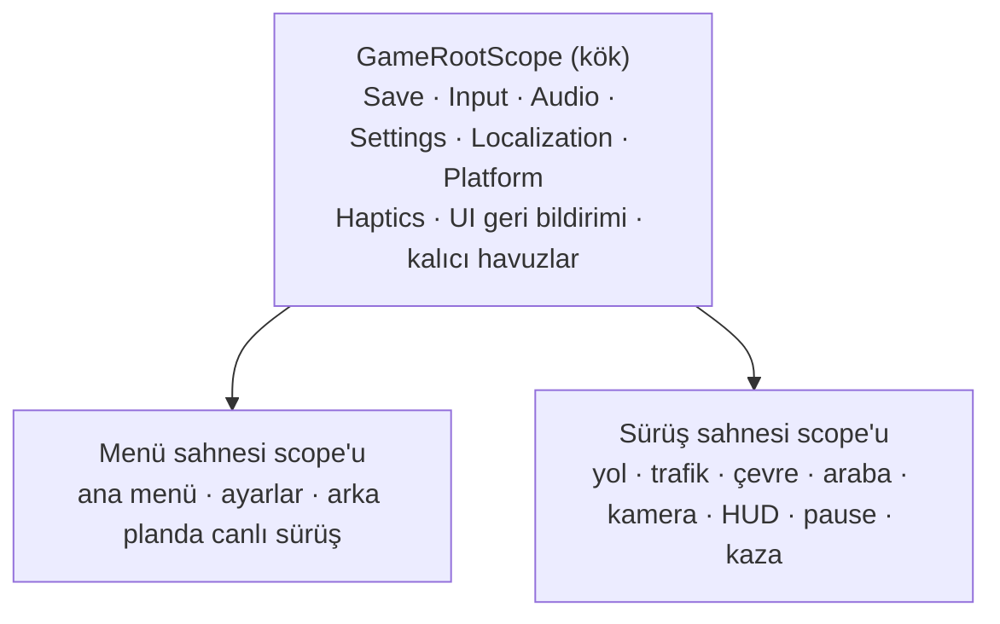
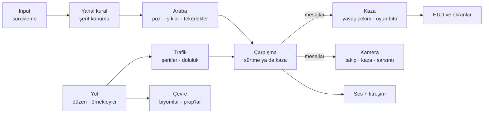

# WrongLine

[English](README.md)

*Yolda kal. Trafiğin arasından geç. Göz kırpma.*

&nbsp;&nbsp;

<em>Gündüz (solda) ve gece (sağda) bir sürüş, ikisi de iki kat hızda.</em>

WrongLine, lunapark rayı gibi inip çıkan ve kıvrılan sonsuz bir yolda geçen, dikey Android araba oyunudur. Ufuk bir shader'la
bükülür, kamera arabanın arkasından gider ve yolun dört şeridi vardır: ikisi senin yönünde, ikisi sana doğru gelir. Arabayı
parmağını yana sürükleyerek yönlendirirsin; gaz da fren de yoktur ve araba sürekli hızlanır. Hafif bir sürtme seni şeridine
geri iter. Gerçek bir çarpışma kazadır: yavaş çekim, araba parçalanır ve tur biter.

Prototip değil, küçük ve bitmiş bir portföy oyunudur: temiz kurallar, testler ve altında bir framework olan gerçek bir Unity
projesi.

## Nasıl oynanır

- **Sürükleyerek yönlendir.** Parmağını sola ve sağa kaydır; araba dört şeridin arasında seni izler. Hız senin elinde değil.
- **Soldaki iki şerit karşıdan gelir.** Oradan geçmek hızlı yoldur ve risklidir.
- **Sürtme kaza değildir.** Sığ bir yan temas arabayı iter ve sana bir şeye mal olmaz; daha derin temas kazadır.
- **Hızlanmaya devam eder.** Hız tur boyunca artar, dolayısıyla uzun süre dayandıkça aynı boşluk daralır.
- **Skor mesafedir.** Oyun bitti ekranı metreni sayarak gösterir ve en iyi turunu verir.
- **Dünya değişir.** Dört biyom, başlangıçta gün ya da gece, karanlıkta sokak lambaları ve farlar. Her tur farklı bir yoldur.

## Ekran görüntüleri

*Ana menü, ayarlar, gündüz ve gece sürüş ekranı ve kaza ekranı.*

## İndir

Bir sürüm yayınlandığında Android APK'sı (Android 7.1 ve üstü, ARM64) projenin
[GitHub Releases](https://github.com/ramazantoy/WrongLine/releases) sayfasına eklenir. Debug anahtarıyla imzalıdır; bilinmeyen
kaynaklardan kuruluma izin vererek kurulur, Play Protect bilinmeyen geliştirici uyarısı verebilir. Oyun hiçbir mağazada
değil. APK repoda tutulmaz, kaynaktan yeniden derlenebilir (aşağıya bak).

## Durum

Menüden kaza ekranına kadar oynanabilir; İngilizce ve Türkçe, ses, müzik ve titreşimle (hepsi Ayarlar'dan kapatılabilir).
Hâlâ pürüzlü olanlar:

- Sesler kendi sentezim ve yalnız ilk ince ayardan geçti.
- Mesafeden başka skor yok: jeton, görev ya da lider tablosu yok.

## Nasıl yapıldı

Unity 6000.3.27f2 (6.3 LTS), Universal Render Pipeline, özel bir ufuk bükme shader'ı ve kamera için Cinemachine 3.1.7.
Kod VContainer, MessagePipe, UniTask, PrimeTween ve Input System kullanır.

Kurallar mümkün olduğunca Unity tipi olmayan düz C#'tır: yol örnekleme, araba ve trafiğin yaşadığı `(s, x)` yol uzayı, sonsuz
yol zinciri, yanal hareket, hız profili, trafik doluluğu (her zaman geçilebilir bir yol vardır), sürtme ve kaza tespiti,
kamera dolly'si. MonoBehaviour'lar yalnızca bunları çizer. Her kural sınıfının EditMode testi vardır (yaklaşık 700 test
metodu) ve her yeni test dosyası, kodu bir kez bozup testin kırıldığı görülerek denendi. Özellikler birbirini küçük
arayüzler ve MessagePipe mesajlarıyla tanır.

Arabalar Meshy ile üretildi ve bir Editor script'iyle oyuna hazır mesh'e pişirildi. Yol parçaları ve yol kenarı prop'ları
Blender'da modellendi, arayüzün fırça sprite'ları Krita'da çizildi, sesler `.claude/scripts/` altındaki Python
script'leriyle sentezlendi. Ayarlanabilir her sayı config asset'lerinde durur.

Altında `Assets/Framework/` var: küçük bir framework (scope'lar, oyun state'leri, sahne yükleme, kayıt, input modları, ses,
havuzlar, ayarlar, yerelleştirme, platform servisleri ve denetimli bir build hattı). Modül modül
[`Assets/Framework/Documentation~`](Assets/Framework/Documentation~/Core.md) altında belgelenmiştir (İngilizce).

## Proje yapısı

| Yol | İçerik |
|---|---|
| `Assets/Game/` | Oyun: `Game` assembly'si, `WrongLine` namespace'i, özellik başına bir klasör (`Road`, `Traffic`, `Car`, `Driving`, `Crash`, `Scenery`, `UI`, `Audio`, `Menu`, ...) |
| `Assets/Game/Tests/` | Kural sınıflarının EditMode testleri (`Game.Tests`) |
| `Assets/Framework/` | Framework (`AF.*`), kendi testleri ve [belgeleriyle](Assets/Framework/Documentation~/Core.md) |
| `.claude/` | Karar kaydı (`decisions/`, alan başına bir dosya), editor ve asset script'leri ve işin izlediği kurallar |
| `CLAUDE.md` | Bu projede Claude Code için çalışma kuralları |

## Kaynaktan derleme

1. Projeyi Unity **6000.3.27f2** ile aç ve OpenUPM paketleri için çıkan imza eksik uyarısını kabul et.
2. Android için Android Build Support'u (SDK, NDK, OpenJDK) kur ve platformu **File > Build Profiles**'tan değiştir.
3. Testleri **Window > General > Test Runner**'dan (EditMode) ve **AF > Validate All** ile koş.
4. **AF > Build > Release** aktif platformu `Builds/<Platform>/Release/` altına derler; bir kontrol başarısızsa derlemeyi reddeder.

## Kaynaklar ve lisanslar

Kod [MIT lisanslıdır](LICENSE). Üçüncü taraf asset'ler ve paketler kendi lisanslarını korur; her asset klasöründe lisans metni
dosyaların yanında durur.

| Asset | Yazar ve kaynak | Lisans |
|---|---|---|
| Barlow ve Barlow Condensed fontları | [The Barlow Project Authors](https://github.com/jpt/barlow) | SIL OFL 1.1 (`Assets/Game/UI/Fonts/Barlow - OFL.txt`) |
| Liberation Sans fontu (TextMesh Pro varsayılanı) | Red Hat, Inc.; sayısallaştırma Google | SIL OFL 1.1 (`Assets/TextMesh Pro/Fonts/LiberationSans - OFL.txt`) |
| Oyuncu ve trafik arabaları | Ücretli planda Meshy ile üretildi, sonra kendi script'lerimle pişirildi ve dokulandı | Kendi işim, kod gibi MIT |
| Yol parçaları, yol kenarı prop'ları, shader'lar, arayüz fırça sprite'ları, açılış videosu | Kendi işim | Kod gibi MIT |
| Ses efektleri, motor döngüleri ve müzik | Kendi Python script'lerimle sentezlendi (`.claude/scripts/audio/`) | Kendi işim, kod gibi MIT |
| Ekran görüntüleri ve GIF'ler | Yazar tarafından Unity Editor'da çalışan oyundan kaydedildi; GIF'ler iki kat hızda oynar | Kendi işim, kod gibi MIT; içindeki font ve görseller yukarıdaki lisansları korur |
| VContainer, UniTask, MessagePipe | [hadashiA](https://github.com/hadashiA/VContainer) ve [Cysharp](https://github.com/Cysharp) | MIT |
| PrimeTween | [Kyrylo Kuzyk](https://github.com/KyryloKuzyk/PrimeTween) | PrimeTween lisansı; şartları gereği npm'den kurulur, bu repoya kopyalanmaz |
| Cinemachine, Input System, Localization, URP ve diğer Unity paketleri; Newtonsoft Json | Unity Technologies; James Newton-King | Unity paket şartları (Package Manager'dan kurulur); MIT |

## Yazarlık

Mimari, kararlar ve gözden geçirme Ramazan Toy'a ait. Kodun büyük kısmı bu yönlendirmeyle Claude Code ile yazıldı; bu
commit'lerde Co-Authored-By satırı var. `CLAUDE.md` ve `.claude/`, işin izlediği kuralları ve karar kaydını tutar.
